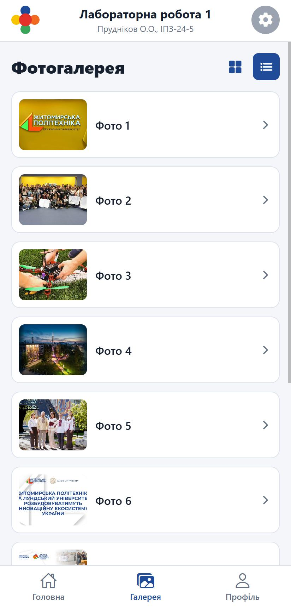
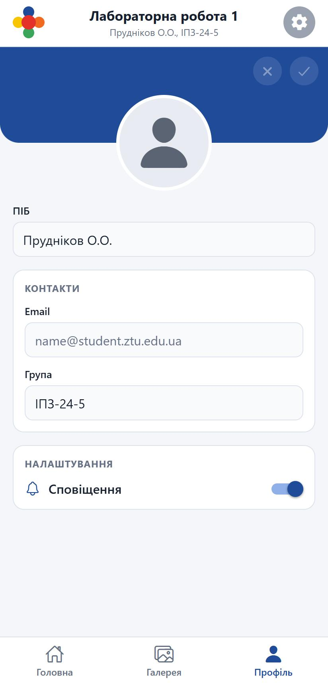

# Лабораторна робота №1

**Тема:** Використання Expo для створення найпростішого додатку React Native. Знайомство з основними компонентами.

**Виконав:** Прудніков О.О., група ІПЗ-24-5

## Опис проєкту

Мобільний застосунок на React Native (Expo SDK 57) з трьома екранами та нижньою навігаційною панеллю (Bottom Tabs в Expo Router). Інтерфейс оформлено в кольорах бренд-системи Державного університету «Житомирська політехніка».

| Екран | Що реалізовано |
|---|---|
| **Головна** | Стрічка новин університету (`FlatList`), картки з зображенням, заголовком, датою та коротким описом; поле пошуку, яке фільтрує новини за текстом |
| **Галерея** | Фотогалерея з перемикачем вигляду: сітка у 2 колонки або список з мініатюрами |
| **Профіль** | Аватар, редаговані поля ПІБ, Email, Група, перемикач сповіщень (`Switch`); кнопки ✕ (скасувати зміни) і ✓ (зберегти) активні лише коли дані змінено |

На всіх екранах зверху спільна шапка: логотип, назва роботи, ПІБ і група, кнопка налаштувань.

**Використані компоненти та бібліотеки:** `View`, `Text`, `TextInput`, `Pressable`, `ScrollView`, `FlatList`, `Switch`, `StyleSheet` + Flexbox, `expo-image`, `expo-router` (Tabs), `@expo/vector-icons` (Ionicons), `react-native-safe-area-context`.

### Структура

```
lab1/
├── assets/images/
│   ├── news/              зображення новин
│   └── gallery/           фото для галереї
├── screenshots/           скріншоти для README
└── src/
    ├── app/
    │   ├── _layout.tsx           кореневий Stack
    │   └── (tabs)/
    │       ├── _layout.tsx       нижня навігація (Bottom Tabs)
    │       ├── index.tsx         Головна
    │       ├── gallery.tsx       Галерея
    │       └── profile.tsx       Профіль
    ├── components/app-header.tsx шапка застосунку
    ├── constants/brand.ts        кольори бренд-системи, дані студента
    └── data/content.ts           новини та фото
```

Зображення новин і фото галереї взято з сайту університету ([ztu.edu.ua](https://ztu.edu.ua), [news.ztu.edu.ua](https://news.ztu.edu.ua)) і збережено локально в `assets`, тому застосунок працює без інтернету.

## Інструкція із запуску

Потрібно: Node.js (LTS), для емулятора - Android Studio з налаштованим AVD, для телефона - застосунок **Expo Go**.

```bash
git clone <посилання на репозиторій>
cd MobileLabsRN2026/lab1
npm install
npx expo start
```

Після запуску в терміналі з'являється QR-код і меню:

| Спосіб | Команда / дія |
|---|---|
| Емулятор Android | `npx expo start --android` або клавіша `a` у терміналі |
| Телефон (одна Wi-Fi мережа) | відсканувати QR-код у Expo Go |
| Телефон (різні мережі) | `npx expo start --tunnel`, потім сканувати QR-код |
| Браузер | `npx expo start --web` або клавіша `w` |
| Якщо не оновлюються стилі/залежності | `npx expo start --clear` |

Нові бібліотеки встановлюються командою `npx expo install <назва>`, яка підбирає версію, сумісну з Expo SDK.

## Скріншоти

Знято у веб-версії застосунку з розміром екрана телефона (412×860).

| Головна | Галерея (сітка) | Галерея (список) | Профіль |
|---|---|---|---|
|  |  |  |  |

## Висновки: способи запуску мобільного додатка

- **Емулятор Android (Android Studio, AVD)** - віртуальний пристрій на комп'ютері. Не потрібен телефон, зручно перевіряти різні розміри екранів і версії Android, працюють інструменти розробника. Мінуси: потребує багато ресурсів (оперативна пам'ять, апаратна віртуалізація), повільніше запускається, не все обладнання (камера, датчики) поводиться як справжнє.
- **Фізичний пристрій через Expo Go (LAN)** - застосунок відкривається на реальному телефоні сканом QR-коду, комп'ютер і телефон мають бути в одній Wi-Fi мережі. Показує реальну швидкодію, жести, клавіатуру й вигляд на справжньому екрані; зміни в коді з'являються майже миттєво (Fast Refresh). Обмеження: Expo Go містить лише вбудовані модулі Expo, для бібліотек з власним нативним кодом потрібна development build.
- **Тунель (`--tunnel`)** - те саме, що Expo Go, але з'єднання йде через публічний тунель, тому працює, коли пристрій і комп'ютер у різних мережах або Wi-Fi блокує підключення (університетська мережа, мобільний інтернет). Повільніше за LAN, бо трафік проходить через зовнішній сервер.
- **Веб-версія (`--web`) та snack.expo.dev** - найшвидший спосіб перевірити верстку без емулятора й телефона, але це не мобільне середовище: частина компонентів поводиться інакше (наприклад, `Alert` і `Switch`), тому фінальну перевірку треба робити на емуляторі або телефоні.

Отже, для щоденної розробки зручно поєднувати емулятор і Expo Go на телефоні, тунель - як запасний варіант при проблемах з мережею, а веб-версію - для швидкої перевірки інтерфейсу.
