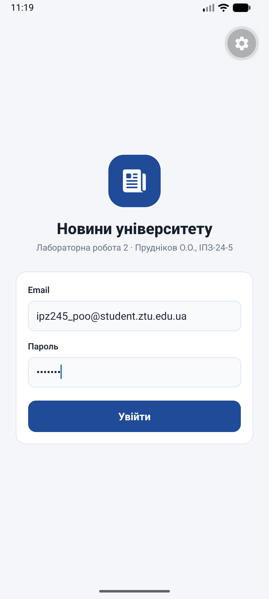
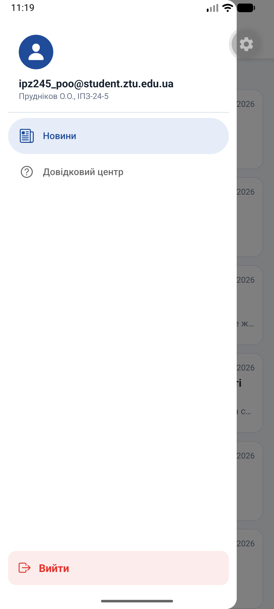

# Лабораторна робота №2

**Тема:** Віртуалізація списків та побудова навігації.

**Виконав:** Прудніков О.О., група ІПЗ-24-5

## Опис проєкту

Застосунок «Новини університету» на React Native (Expo SDK 57, Expo Router) з авторизацією, бічним меню (Drawer), вкладеним стеком новин, віртуалізованими списками `FlatList` і `SectionList`.

| Що реалізовано | Де |
|---|---|
| Контекст авторизації: `isAuthenticated`, `login()`, `logout()`; провайдер обгортає кореневий layout | `src/context/auth.jsx`, `src/app/_layout.jsx` |
| Публічний екран входу з перевіркою email і пароля; після входу - перехід у застосунок | `src/app/login.jsx` |
| Захищена Drawer-навігація: неавторизованого користувача `<Redirect>` веде на вхід; у меню кнопка «Вийти» | `src/app/(drawer)/_layout.jsx` |
| Вкладений Stack новин усередині Drawer з `headerShown: false` | `src/app/(drawer)/(news)/_layout.jsx` |
| Стрічка з 200 новин: `FlatList`, Pull-to-Refresh, Infinite Scroll (`onEndReached`, `onEndReachedThreshold`), `getItemLayout`, картка в `React.memo` | `src/app/(drawer)/(news)/index.jsx`, `src/components/news-card.jsx` |
| Деталі новини - динамічний маршрут, `id` через `useLocalSearchParams` | `src/app/(drawer)/(news)/[id].jsx` |
| Довідковий центр: питання й відповіді за темами в `SectionList`, відповідь розгортається натисканням | `src/app/(drawer)/faq.jsx` |
| Safe areas: `SafeAreaView` на екрані входу, `useSafeAreaInsets` у меню | `login.jsx`, `(drawer)/_layout.jsx` |

### Структура маршрутів

```
src/app/
├── _layout.jsx            Stack + AuthProvider (кореневий)
├── login.jsx              /login - вхід (публічний)
└── (drawer)/
    ├── _layout.jsx        Drawer + перевірка авторизації (Redirect)
    ├── faq.jsx            /faq - довідковий центр (SectionList)
    └── (news)/
        ├── _layout.jsx    вкладений Stack (headerShown: false)
        ├── index.jsx      / - стрічка новин (FlatList)
        └── [id].jsx       /[id] - деталі новини
```

Новини генеруються програмно (`src/data/news.js`) і віддаються сторінками по 20 з затримкою, що імітує запит до сервера.

## Інструкція із запуску

```bash
git clone <посилання на репозиторій>
cd MobileLabsRN2026/lab2
npm install
npx expo start
```

- `a` - відкрити в емуляторі Android, QR-код - на телефоні в Expo Go, `w` - у браузері;
- `npx expo start --clear` - з очищенням кешу, `npx expo start --tunnel` - якщо телефон і ПК в різних мережах.

Для входу підходить будь-який коректний email і пароль від 6 символів.

## Скріншоти (емулятор Android)

| Вхід | Стрічка новин | Pull-to-Refresh | Infinite Scroll |
|---|---|---|---|
|  |  |  |  |

| Деталі новини | Бічне меню | Довідковий центр |
|---|---|---|
|  |  |  |

## Висновки та відповіді на контрольні запитання

**1. Як працює вкладена навігація в архітектурі Expo Router?**
Навігація будується зі структури папок: кожна папка може мати свій `_layout`, який визначає тип навігатора для екранів усередині неї. Layout-и вкладаються один в одного так само, як папки. У цьому проєкті кореневий `_layout` - це `Stack` (вхід і група `(drawer)`), всередині `(drawer)/_layout` - `Drawer` (новини і довідковий центр), а всередині `(news)/_layout` - ще один `Stack` (список і деталі). Папки в дужках - групи маршрутів: вони об'єднують екрани під спільним layout, але не потрапляють в адресу (`/faq`, а не `/(drawer)/faq`). Щоб заголовки не дублювались, у вкладеного Stack вимкнено `headerShown`.

**2. Яким чином реалізується захист маршрутів від неавторизованого доступу?**
Стан авторизації зберігається в контексті (`AuthProvider`), який обгортає весь застосунок. Layout захищеної групи `(drawer)` перед рендером перевіряє `isAuthenticated`: якщо користувач не увійшов, повертає `<Redirect href="/login" />`, і жоден екран групи не відкривається. Після `login()` стан змінюється і layout повертає `Drawer`; після `logout()` - знову перенаправляє на вхід. Так само екран входу перенаправляє вже авторизованого користувача в застосунок.

**3. Чим FlatList відрізняється від ScrollView та що таке віртуалізація списків?**
`ScrollView` рендерить увесь вміст одразу, тому на великих списках витрачає багато пам'яті й гальмує. `FlatList` віртуалізує список: рендерить лише елементи у видимій області та невеликий запас навколо, а ті, що далеко за межами екрана, прибирає з пам'яті. Додатково він підтримує ліниве підвантаження (`onEndReached`), оновлення жестом (`refreshControl`), а `getItemLayout` дозволяє не вимірювати елементи однакової висоти. `React.memo` для картки не дає перемальовувати вже показані новини, коли додаються нові.

**4. Як отримати параметри динамічного маршруту на цільовому екрані в Expo Router?**
Файл з назвою в квадратних дужках (`[id].jsx`) - динамічний маршрут, частина адреси стає параметром. Перехід робиться через `router.push({ pathname: '/[id]', params: { id } })` або `<Link>`, а на цільовому екрані параметр отримується хуком `useLocalSearchParams()`: `const { id } = useLocalSearchParams();`. Значення приходить рядком.

**5. Яку структуру даних приймає компонент SectionList?**
Масив секцій у пропсі `sections`. Кожна секція - об'єкт з обов'язковим масивом `data` (елементи секції) і довільними полями, наприклад `title`: `[{ title: 'Новини', data: [{ id, question, answer }, ...] }, ...]`. Елементи малює `renderItem`, заголовки секцій - `renderSectionHeader`, а `stickySectionHeadersEnabled` закріплює заголовок зверху під час прокручування.
