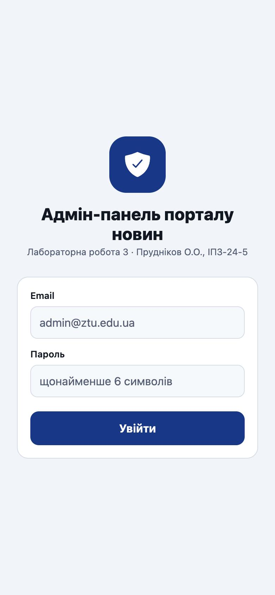
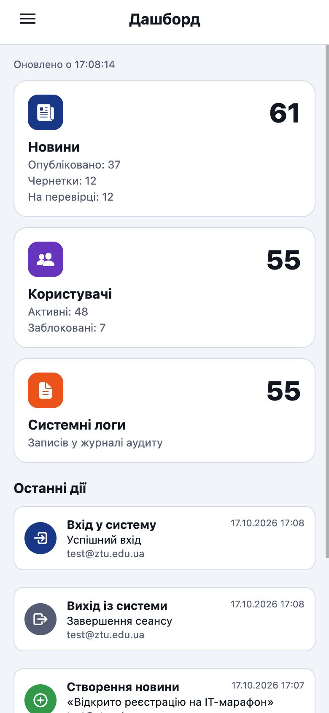
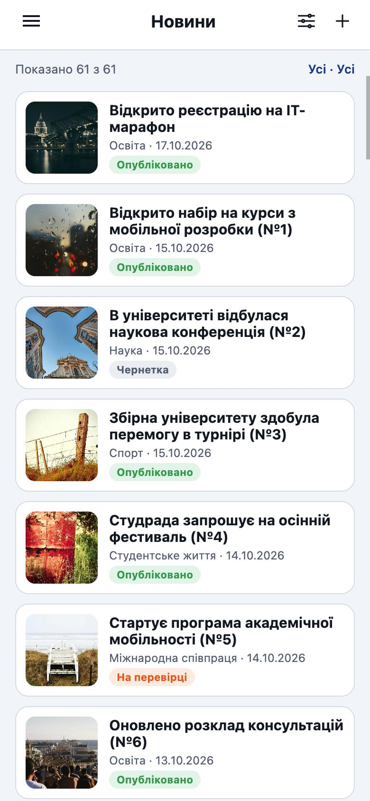
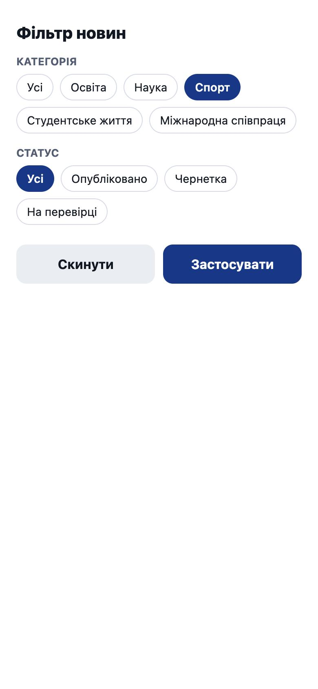
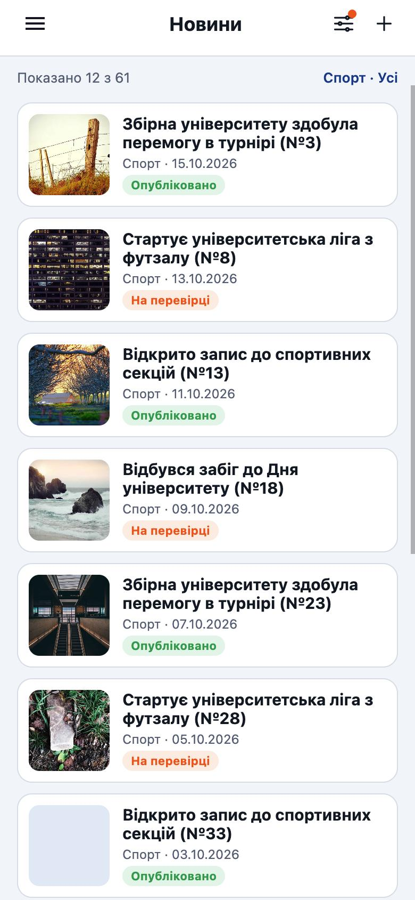
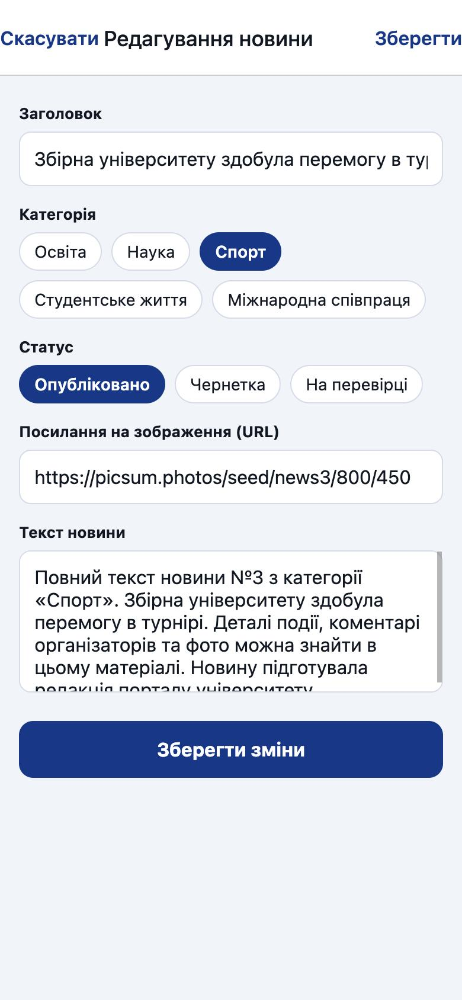
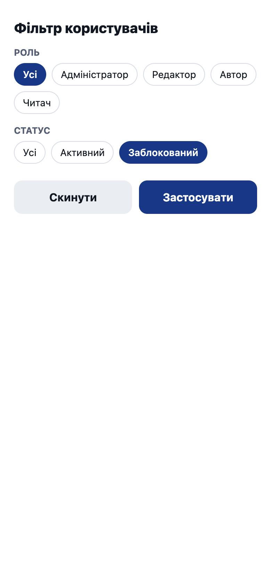
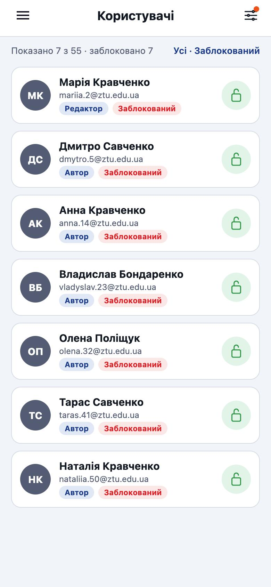

# Лабораторна робота №3

**Тема:** Expo Router: кастомізація навігаційних компонентів, нативні модальні вікна та віртуалізація списків.

**Виконав:** Прудніков О.О., група ІПЗ-24-5

## Опис проєкту

Прототип модуля адміністрування порталу новин на React Native (Expo SDK 57, Expo Router). Код частково перенесено з лабораторної роботи №2 (авторизація, тема, Drawer).

| Що реалізовано | Де |
|---|---|
| Екран входу, захист маршрутів через `Stack.Protected` | `src/app/login.jsx`, `src/app/_layout.jsx` |
| Група маршрутів адмін-панелі `(admin)` з навігатором `<Drawer>` | `src/app/(admin)/_layout.jsx` |
| Власне бокове меню `drawerContent={(props) => <AdminDrawerContent {...props} />}`: профіль (аватар, ім'я, пошта), пункти Дашборд / Новини / Користувачі / Системні логи, кнопка «Вийти» внизу | `src/components/admin-drawer-content.jsx` |
| Власний хедер через `screenOptions.header` (меню або «Назад», заголовок, кнопки праворуч) | `src/components/admin-header.jsx` |
| Локальні масиви: 60 новин, 55 користувачів, 50 логів | `src/data/generate.js`, `src/data/store.js` |
| Дашборд з кількістю новин, користувачів і логів, оновлення через `useFocusEffect` | `src/app/(admin)/index.jsx` |
| Список новин на `VirtualizedList` (`getItem`, `getItemCount`, `getItemLayout`, `initialNumToRender`, `maxToRenderPerBatch`, `windowSize`, `removeClippedSubviews`) | `src/app/(admin)/news/index.jsx` |
| Деталі новини `/news/[id]`, `id` через `useLocalSearchParams` | `src/app/(admin)/news/[id].jsx` |
| Створення та редагування новини у вікні `presentation: 'modal'`, видалення з підтвердженням `Alert.alert()` | `src/app/news-form.jsx`, `src/utils/confirm.js` |
| Користувачі на `VirtualizedList`, зміна статусу Активний / Заблокований | `src/app/(admin)/users.jsx` |
| Журнал системних логів на `VirtualizedList` | `src/app/(admin)/logs.jsx` |
| Фільтри новин і користувачів у `presentation: 'formSheet'` з `sheetAllowedDetents: [0.6, 0.9]` | `src/app/news-filter.jsx`, `src/app/users-filter.jsx` |
| Safe areas: `SafeAreaView` на вході, `useSafeAreaInsets` у хедері, меню і списках | `login.jsx`, `admin-header.jsx`, `admin-drawer-content.jsx` |

Лог записується лише при шести подіях: вхід, вихід, створення, редагування і видалення новини, зміна статусу користувача.

### Структура маршрутів

```
src/app/
├── _layout.jsx          Stack + AuthProvider, Stack.Protected, опції modal / formSheet
├── login.jsx            /login - вхід
├── news-form.jsx        /news-form - створення та редагування (modal)
├── news-filter.jsx      /news-filter - фільтр новин (formSheet)
├── users-filter.jsx     /users-filter - фільтр користувачів (formSheet)
└── (admin)/
    ├── _layout.jsx      Drawer + AdminDrawerContent + власний header
    ├── index.jsx        / - дашборд
    ├── users.jsx        /users - користувачі
    ├── logs.jsx         /logs - системні логи
    └── news/
        ├── _layout.jsx  Stack новин
        ├── index.jsx    /news - список новин
        └── [id].jsx     /news/[id] - перегляд новини
```

## Інструкція із запуску

```bash
git clone <посилання на репозиторій>
cd MobileLabsRN2026/lab3
npm install
npx expo start
```

- `a` - емулятор Android, QR-код - телефон в Expo Go, `i` - симулятор iOS, `w` - браузер;
- `npx expo start --clear` - з очищенням кешу, `npx expo start --tunnel` - якщо телефон і ПК в різних мережах;
- нові бібліотеки встановлювати командою `npx expo install <назва_бібліотеки>`.

Для входу підходить будь-який коректний email і пароль від 6 символів, або тестовий користувач `test` / `test`.

## Скріншоти

Скріншоти зроблено у веб-версії (`npx expo start --web`) з розміром екрана телефона. У браузері `formSheet` відкривається на весь екран, на iOS і Android це висувна панель з двома висотами.

| Вхід | Дашборд | Бокове меню | Новини |
|---|---|---|---|
|  |  |  |  |

| Фільтр новин | Результат фільтра | Перегляд новини | Редагування (modal) |
|---|---|---|---|
|  |  |  |  |

| Користувачі | Фільтр користувачів | Заблоковані | Системні логи |
|---|---|---|---|
|  |  |  |  |

## Висновки та відповіді на контрольні запитання

У роботі побудовано адмін-панель порталу новин на файловій маршрутизації Expo Router: група `(admin)` з Drawer і власним бічним меню, вкладений Stack новин з динамічним маршрутом, нативні модальні вікна для форми і фільтрів. Усі три великі списки зроблено на `VirtualizedList` з фіксованою висотою рядка, тому `getItemLayout` дозволяє не вимірювати елементи, а список рендерить лише видиму частину.

**1. Яким чином виконується кастомізація бічного меню та хедера стекової навігації за допомогою drawerContent та screenOptions.header?**
`drawerContent` приймає функцію, яка отримує props навігатора (`state`, `navigation`, `descriptors`) і повертає власний компонент меню. У проєкті це `AdminDrawerContent`: зверху блок профілю, далі `DrawerItemList {...props}`, який сам малює пункти для всіх екранів Drawer з їхніми `drawerLabel` і `drawerIcon`, а внизу поза `DrawerContentScrollView` закріплена кнопка «Вийти». `screenOptions.header` повністю замінює стандартний хедер: функція отримує `navigation`, `route`, `options` і (для Stack) `back`. `AdminHeader` використовує їх так: якщо є `back`, показує кнопку «Назад», інакше `DrawerToggleButton`; заголовок береться з `options.title`, а праворуч рендериться `options.headerRight`. Один компонент працює і в Drawer, і в Stack новин.

**2. У чому відмінність між нативними режимами модальних вікон presentation: 'modal' та presentation: 'formSheet'?**
`modal` відкриває екран поверх поточного майже на всю висоту (на iOS - картка, під якою видно попередній екран, закривається свайпом вниз; на Android - повноекранний екран). Він підходить для самостійних задач, як форма створення новини, і може мати власний хедер з кнопками «Скасувати» / «Зберегти». `formSheet` - висувна нижня панель (bottom sheet), висоту якої задають `sheetAllowedDetents` (тут 60 % і 90 % екрана), також є `sheetGrabberVisible`, `sheetCornerRadius`, `sheetInitialDetentIndex`. Вона займає лише частину екрана, тому підходить для коротких дій на кшталт фільтрів, коли користувач має бачити контекст під панеллю.

**3. Для чого використовується хук useFocusEffect і чим він відрізняється від стандартного useEffect?**
`useEffect` виконується після монтування компонента і при зміні залежностей. Екрани в Drawer і Stack після першого відкриття залишаються змонтованими, тому при поверненні на них `useEffect` повторно не спрацьовує. `useFocusEffect` виконує колбек щоразу, коли екран отримує фокус, а функцію очищення - коли фокус втрачає. Колбек треба обгортати в `useCallback`, інакше ефект запускатиметься на кожному рендері. На дашборді він перераховує кількість новин, користувачів і логів при кожному переході на екран, тому після створення новини чи блокування користувача цифри одразу актуальні.
